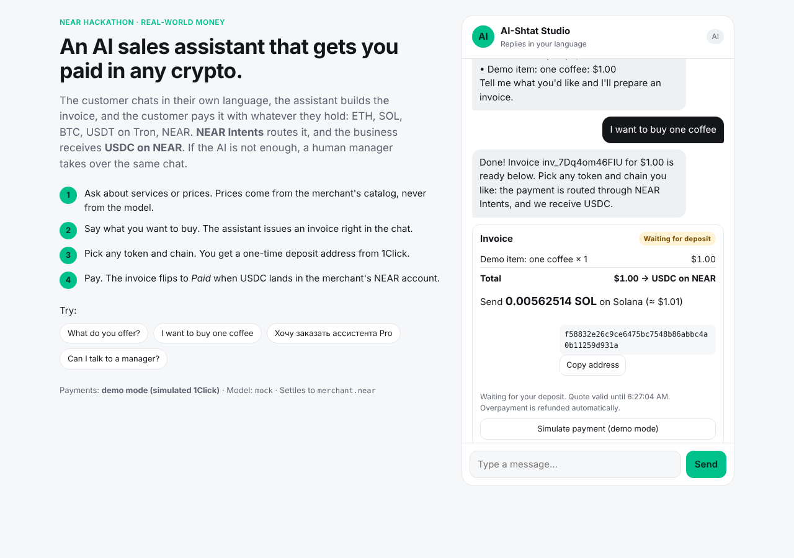
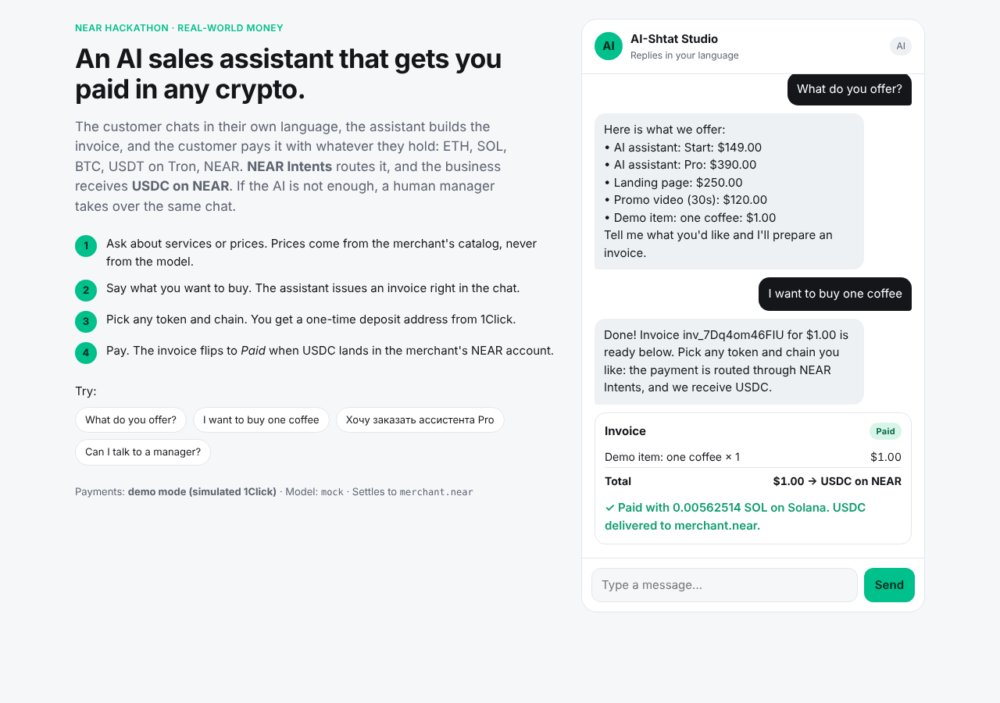
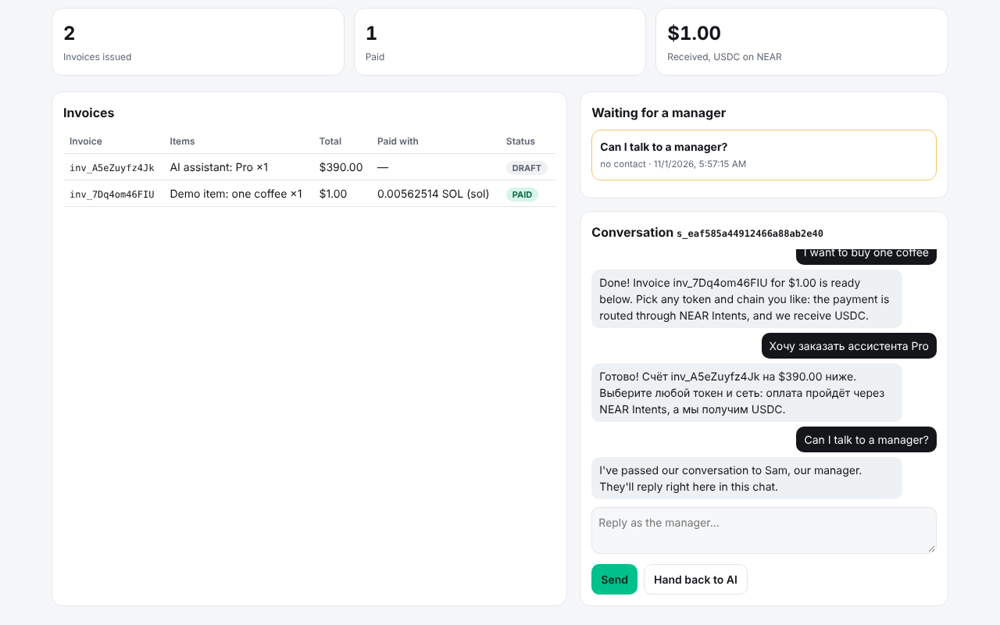

# AI-Shtat Pay

**An AI sales assistant that sells in chat and gets the business paid in any crypto, on any chain. The business always receives USDC on NEAR.**

Built at **NEAR HACKATHON** (Nov 1–14, 2026). Tracks: Real-World Money · Autonomous Business · Agent Economy.

A small business puts a chat assistant on its website. A customer asks about services in their own language, decides to buy, and the assistant issues an invoice right in the chat. The customer pays with whatever they hold (ETH, SOL, BTC, USDT on Tron, NEAR, USDC on any L2). **NEAR Intents** (1Click API) routes the payment, and the merchant receives exactly the invoice amount in **USDC on their NEAR account**. When the AI isn't enough, a human manager takes over the same chat from the merchant desk.

| Chat: quote taken, waiting for deposit | Paid | Merchant desk |
|---|---|---|
|  |  |  |

---

## Run it (60 seconds, no keys needed)

```bash
git clone https://github.com/Dengel88/NEARHACKATON && cd NEARHACKATON
python3 -m venv .venv && . .venv/bin/activate
pip install -r requirements-dev.txt
uvicorn main:app --port 8000
```

Open <http://localhost:8000>, click **"I want to buy one coffee"**, pick a token, enter any refund address, press **Get payment address**, then **Simulate payment (demo mode)**. The invoice turns **Paid** within a few seconds. Open <http://localhost:8000/merchant> to see the merchant desk.

By default the app runs in **mock mode**: a rule-based assistant and a simulated 1Click API, so the full flow works offline with no API keys. Switch to the real thing with `.env` (see below).

```bash
pytest -q          # 26 tests: domain rules, full payment flow, live-client request shapes
```

## Live mode

Copy `.env.example` to `.env` and set:

| Variable | What it does |
|---|---|
| `ONECLICK_MODE=live` | Real NEAR Intents 1Click API (`https://1click.chaindefuser.com`, mainnet). |
| `ONECLICK_API_KEY` | Optional partner key. Without it 1Click adds a 0.25% fee. |
| `MERCHANT_NEAR_ACCOUNT` | The NEAR account that receives USDC. |
| `LLM_PROVIDER=gemini` + `GEMINI_API_KEY` | Google Gemini through its OpenAI-compatible endpoint (`GEMINI_MODEL`, default `gemini-3.8-flash`). |
| `LLM_PROVIDER=openai` | Any OpenAI-compatible endpoint with tool calling. |
| `LLM_BASE_URL`, `LLM_API_KEY`, `LLM_MODEL` | Defaults point to **NEAR AI Cloud** (private inference in TEEs). |
| `TELEGRAM_BOT_TOKEN`, `TELEGRAM_CHAT_ID` | Optional: ping the manager in Telegram on handoff. |
| `MERCHANT_DASHBOARD_TOKEN` | Optional: protect `/merchant` with `?token=…`. |

Check the live 1Click wiring without moving funds:

```bash
python scripts/check_live.py   # /v0/tokens + dry EXACT_OUTPUT quotes for a $1 invoice
```

Verified on mainnet (2026-11-03): `USDC_ASSET_ID` matches USDC on NEAR, all 10 offered tokens exist, and a $1 invoice
quotes at about $1.015 from NEAR, Ethereum, Base, Arbitrum and Solana. Tron USDT (min $100) and BTC (min ~0.064 BTC)
have route minimums above small invoices; 1Click's error is shown to the customer as is.

## Deploy

Docker + Caddy (auto HTTPS) on any VPS: `cp .env.example .env`, set `DOMAIN` and keys, `docker compose up -d --build`.
Vercel also works for a preview. Details and trade-offs: [DEPLOY.md](DEPLOY.md).

## How a payment works

```
customer ──chat──▶ assistant (LLM + 3 tools) ──create_invoice(sku, qty)──▶ server prices it from config.yaml
   │
   └─ picks token + chain ──▶ POST /v0/quote  (1Click, swapType = EXACT_OUTPUT)
                                 originAsset      = e.g. SOL on Solana
                                 destinationAsset = USDC on NEAR
                                 amount           = invoice total in USDC units
                                 recipient        = merchant NEAR account
                              ◀── one-time depositAddress + amountIn
   customer sends amountIn ──▶ depositAddress
   server polls GET /v0/status ──▶ PENDING_DEPOSIT → PROCESSING → SUCCESS ⇒ invoice PAID
```

**EXACT_OUTPUT** is what makes this an invoice and not a swap: the merchant gets exactly the billed amount, the customer's chain and token don't matter, slippage is on the customer's side, and any overpayment is refunded by 1Click to the customer's refund address.

## What is enforced in code, not in the prompt

| Rule | Where |
|---|---|
| The model chooses SKUs and quantities only. Prices and totals come from `config.yaml`. A model that invents a price or SKU gets an error back, never an invoice. | `app/domain.py: build_invoice_lines` |
| Settlement amount is computed in integer USDC units (6 decimals) with explicit rounding. | `app/domain.py: to_units` |
| Paid / Refunded / Failed / Expired are final; nothing moves an invoice out of them. Unknown 1Click statuses are errors, never "paid". | `app/domain.py` |
| Only tokens from the merchant's allow-list can be used to pay. | `app/payments.py: start` |
| One payment in flight per invoice. | `app/payments.py: start` |
| After a handoff, the AI stays silent until the manager hands the chat back. | `app/agent.py: handle` |
| The quote's `signature` and `correlationId` are stored with the invoice, as 1Click recommends for disputes. | `app/payments.py` |

## Layout

```
main.py              entry point (uvicorn / Vercel)
app/main.py          HTTP API, error mapping
app/agent.py         tool-calling loop, system prompt, manager handoff
app/llm.py           OpenAI-compatible provider (NEAR AI Cloud) + offline mock
app/oneclick.py      1Click client (live) + simulator (mock)
app/payments.py      invoice payment lifecycle
app/domain.py        business rules
app/store.py         SQLite
web/index.html       customer chat widget with pay flow
web/merchant.html    merchant desk: invoices, revenue, handoff queue, replies
config.yaml          merchant, catalog, accepted tokens
Dockerfile           production image (uvicorn, SQLite on /data volume)
docker-compose.yml   app + Caddy with automatic HTTPS (deploy/Caddyfile)
```

## API

| Method | Path | |
|---|---|---|
| POST | `/api/chat` | `{session_id, message}` → assistant replies, invoices |
| GET | `/api/chat/{sid}/messages?after=` | new messages (manager replies) |
| GET | `/api/tokens` | accepted tokens |
| POST | `/api/invoices/{id}/pay` | `{origin_asset, refund_to}` → deposit address |
| GET | `/api/invoices/{id}` | invoice with live status |
| POST | `/api/invoices/{id}/tx` | optional: submit deposit tx hash to speed up |
| GET | `/api/merchant/overview` | invoices, revenue, handoffs |
| POST | `/api/merchant/sessions/{sid}/reply` | `{text, release}` |

## Status

Work in progress during the hackathon. See [HANDOFF.md](HANDOFF.md) for the current state and next steps.

All code in this repository was written during NEAR HACKATHON, after the announcement.
